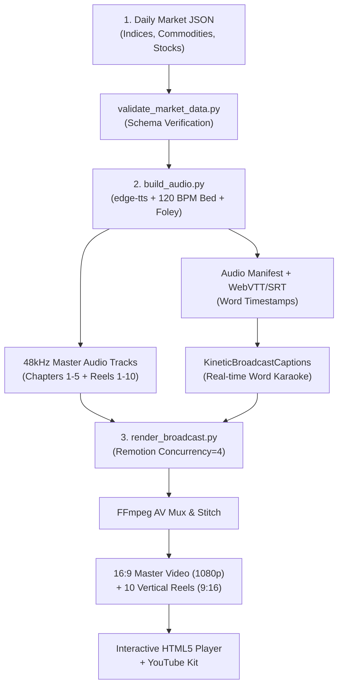

# DEMA Broadcast Master 📺⚡
> **Algorithmic Financial Newsroom & Daily Market Study Suite for Antigravity & Remotion**

[](https://opensource.org/licenses/MIT)
[](https://www.remotion.dev)
[](https://python.org)
[]()
[]()

**DEMA Broadcast Master** is an agentic, institutional video production pipeline that transforms daily post-market telemetry data and TradingView screenshots into complete multi-format financial broadcast packages:
1. **16:9 Television Newsroom Master Video** (`1920×1080 @ 30fps`, ~03:50 duration, 5 structured acts).
2. **10 Standalone 9:16 Vertical Reels** (`1080×1920 @ 30fps`, 36–40s each, Shorts/Reels/TikTok ready).
3. **Word-by-Word Kinetic Karaoke Captions** burned in real time with active gold pill highlight pops.
4. **Procedural 120 BPM Newsroom Score Bed & Split-Flap Foley** mixed to broadcast standard `-14 LUFS`.
5. **Interactive HTML5 Web Streaming Player** with 1-click chapter jumps, WebVTT CC toggle, and instant downloads.
6. **YouTube SEO & Publishing Kit** (`.md`) with timestamps, descriptions, tags, and verified figures.

---

## 🏛️ Broadcast Architecture & Visual Doctrine

Built on the `lemo-opuscar` (`news-package`) visual language:
* **Palette**: `#121417` (Deep Obsidian Ink), `#1B1E23` (Card Neutral), `#F2CF1D` (Amber Gold Accent), `#10B981` (Bullish Green), `#FE6B3D` (Crimson Alert), `#F4F1E8` (Paper White).
* **Typography**: Barlow Condensed (Display Headers), IBM Plex Mono (Telemetry & Values), Inter (Body UI).
* **Order Flow Visualization**: Moving average ribbons (20, 50, 100, 200 DEMA), Volume Profile (VAH, VAL, Point of Control), and split-flap mechanical flip board.



---

## 🎙️ The Kinetic Karaoke Caption Engine

Captions employ a dual-safe-zone, word-by-word karaoke highlighting engine:
* **Active Spoken Word**: Pops with a glowing `#F2CF1D` gold background pill, ink text (`#121417`), bold weight `800`, scale `1.10`, and glowing drop shadow.
* **Prior Spoken Words**: Crisp high-contrast white (`#FFFFFF`, weight `700`).
* **Upcoming Words**: Translucent muted paper (`rgba(244, 241, 232, 0.45)`).
* **Sliding Anti-Clutter Window**: Automatically pages **7 words on 9:16 vertical reels** and **10 words on 16:9 master broadcasts** to ensure zero chart occlusion.
* **Safe Zone Geometry**:
  * **16:9 Master Broadcast**: Positioned at `bottom: 122px` directly above the lower third strap (`bottom: 24px`, height `92px`).
  * **9:16 Vertical Reels**: Positioned at `bottom: 228px` directly above the vertical lower third strap (`bottom: 112px`).

---

## 📦 Directory Structure

```text
dema-broadcast-master/
├── SKILL.md                          # Antigravity skill specification
├── README.md                         # Presentation & quickstart manual
├── LICENSE                           # MIT License
├── .gitignore                        # Standard exclusions
├── scripts/
│   ├── build_audio.py                # TTS + 120 BPM score bed + foley + auto-SRT/VTT generator
│   ├── render_broadcast.py           # Automated Remotion render + FFmpeg AV muxing
│   └── validate_market_data.py       # Strict JSON schema validator for market numbers
├── templates/
│   ├── DemaMasterChapters.jsx        # 5-act master broadcast Remotion composition
│   ├── SharedNewsPackage.jsx         # UI atoms: KineticBroadcastCaptions, SplitFlapChar, etc.
│   ├── DemaMasterRoot.jsx            # Remotion composition root configuration
│   └── master-video-player.html      # Interactive streaming web player with CC track
├── schemas/
│   ├── market_data_schema.json       # JSON Schema definition for daily market telemetry
│   └── sample_market_data.json       # Production sample dataset
└── references/
    ├── broadcast-doctrine.md         # Screen hierarchy, safe zones, split-flap timing
    ├── sound-design.md               # 120 BPM procedural financial score bed formulas & foley
    └── caption-system.md             # Kinetic word-by-word karaoke rules & WebVTT/SRT specs
```

---

## 🚀 Quickstart Guide

### 1. Requirements
* Node.js 18+ and npm
* Python 3.10+ (`numpy`, `edge-tts`, `jsonschema`)
* FFmpeg and FFprobe on PATH

### 2. Validate Daily Market Telemetry
```bash
python scripts/validate_market_data.py schemas/sample_market_data.json
```

### 3. Generate Audio & Synchronized Subtitles
Synthesizes high-fidelity narration (`en-IN-PrabhatNeural`), 120 BPM procedural electronic score, tactile split-flap flip clicks, and WebVTT/SRT files:
```bash
python scripts/build_audio.py --voice "en-IN-PrabhatNeural" --out-dir "outputs/audio"
```

### 4. Render Master Video & Vertical Reels
Renders all compositions with concurrency, muxes audio, and stitches the master broadcast:
```bash
python scripts/render_broadcast.py --concurrency 4 --audio-dir "outputs/audio" --out-dir "outputs/videos"
```

### 5. Launch Interactive Player
```bash
python -m http.server 8080
```
Open `http://localhost:8080/templates/master-video-player.html` in your browser.

---

## ⚖️ Educational Compliance Disclaimer

All videos produced using this suite carry explicit disclaimers:
> *This broadcast is created strictly for technical chart analysis and educational study. Content does not constitute SEBI-registered investment advice, stock tips, or trading recommendations.*

---

## 📄 License

Distributed under the **MIT License**. See `LICENSE` for details.

