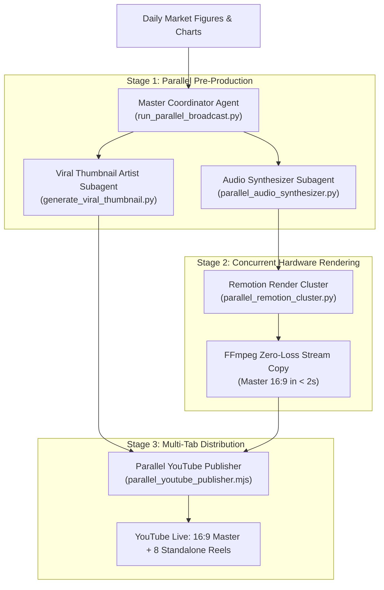

# DEMA Broadcast Master 📺⚡
> **Ultra-Parallel Multi-Agent Financial Newsroom & High-Retention Viral Reels Suite for Antigravity & Remotion**

[](https://opensource.org/licenses/MIT)
[](https://www.remotion.dev)
[](https://python.org)
[]()
[]()
[]()

**DEMA Broadcast Master (v3.0.0)** is an ultra-fast, multi-agent automated video production pipeline that transforms daily post-market telemetry data and technical chart studies into complete broadcast video suites:
1. **16:9 Television Newsroom Master Video** (`1920×1080 @ 30fps`, 5–8 structured acts, mechanical split-flap matrix, global macro split-cards, and order flow footprints).
2. **9:16 Viral Social Reels** (`1080×1920 @ 30fps`, Shorts/Reels/TikTok ready, powered by the **6-Pillar Engagement Formula**).
3. **Ultra-Parallel Multi-Agent Engine**: Concurrent execution across audio synthesis, procedural score generation, viral thumbnail design, Remotion rendering, and YouTube Studio uploading.
4. **Hinglish Viral Thumbnail Generator**: 16:9 Master & 9:16 vertical high-CTR thumbnails with high-contrast typography, gold/emerald neon glows, and verified chart zooms.
5. **Multi-Tab Parallel YouTube Studio Publisher**: CDP Puppeteer uploader that publishes master broadcasts and reels concurrently across isolated browser tabs.
6. **Zero Voice Overlap Engine**: Sequential chunk scheduling, procedural 120 BPM electronic score bed, and 45Hz sub-bass impact drops.
7. **Master 3-Act Video Sequence**: Branded DEMA Intro Sting (`3.5s / 105 frames`), Dynamic Technical Core, and responsive DEMA Outro End Card (`5.0s / 150 frames`).

---

## 🏛️ Ultra-Parallel Multi-Agent Architecture



---

## ⚡ Quick Start: Parallel Production

### 1. Full End-to-End Parallel Execution
Generate all audio, render all videos, author viral thumbnails, and upload to YouTube Studio in parallel:
```bash
python scripts/run_parallel_broadcast.py \
  --market-data data/dema_suite_20261113.json \
  --render-workers 3 \
  --upload-workers 2 \
  --upload
```

### 2. Standalone Parallel Modules

#### A. Parallel Audio & Procedural Score
```bash
python scripts/parallel_audio_synthesizer.py
```

#### B. High-CTR Viral Thumbnails (16:9 & 9:16)
```bash
# 16:9 Master Video Thumbnail
python scripts/generate_viral_thumbnail.py \
  --format 16x9 \
  --out DEMA_Master_Viral_Thumbnail.jpg \
  --headline "NIFTY 50 BREAKOUT & GOLD SURGE" \
  --sub "136M Volume Blast! बड़ा उलटफेर शुरू?" \
  --chart modi-remotion/public/charts/FIRSTCRY_1D_chart.png

# 9:16 Vertical Reel Thumbnail
python scripts/generate_viral_thumbnail.py \
  --format 9x16 \
  --out DEMA_Reel_FIRSTCRY_9x16_thumb.jpg \
  --headline "FIRSTCRY BREAKOUT" \
  --sub "12.8% Blast या Trap?" \
  --ticker "FIRSTCRY" \
  --chart modi-remotion/public/charts/FIRSTCRY_1D_chart.png
```

#### C. Multi-Process Remotion Render Cluster
```bash
python scripts/parallel_remotion_cluster.py
```

#### D. Multi-Tab Parallel YouTube Studio Publisher
```bash
node scripts/parallel_youtube_publisher.mjs upload_manifest.json 2
```

---

## 📁 Repository Structure

```text
.agents/skills/dema-broadcast-master/
├── SKILL.md                                 # Master instruction manual (v3.0.0)
├── README.md                                # Public documentation
├── scripts/
│   ├── run_parallel_broadcast.py            # Master orchestrator
│   ├── parallel_audio_synthesizer.py        # Async voice & 120 BPM bed mixer
│   ├── parallel_remotion_cluster.py         # Multi-process Remotion render cluster
│   ├── generate_viral_thumbnail.py          # 16:9 and 9:16 viral thumbnail generator
│   ├── parallel_youtube_publisher.mjs       # Multi-tab YouTube Studio uploader
│   ├── build_stock_explainer_audio.py       # Universal 6-beat stock explainer audio
│   ├── render_stock_explainers.py           # Universal stock explainer renderer
│   ├── build_audio.py                       # 16:9 broadcast TTS + 120 BPM bed
│   ├── build_reel_audio.py                  # 9:16 Zero-overlap TTS engine + SFX
│   ├── render_broadcast.py                  # 16:9 Remotion concurrency render
│   ├── render_reels.py                      # 9:16 Vertical reels renderer
│   └── validate_market_data.py              # Telemetry JSON schema validator
├── templates/
│   ├── StockExplainerReel.jsx               # Universal 9:16 Vertical Explainer Reel
│   ├── StockYouTubeExplainer16x9.jsx        # Universal 16:9 Widescreen Masterclass
│   ├── CumminsYouTubeExplainer16x9.jsx      # Benchmark 16:9 Widescreen Explainer
│   ├── CumminsExplainerReel.jsx             # Benchmark 9:16 Support/Resistance Reel
│   ├── CumminsMotionDoctrineReel.jsx        # 3-Act Next-Gen Cummins Reel
│   ├── DemaIntro.jsx                        # Master DEMA intro sting (3.5s)
│   ├── DemaOutro.jsx                        # Master DEMA outro end card (5.0s)
│   ├── DemaMasterRoot.jsx                   # Universal Remotion Root
│   ├── SharedNewsPackage.jsx                # UI components: Captions, Straps, Wipes
│   ├── DemaMasterChapters.jsx               # Complete 5-act broadcast Remotion component
│   └── brand.json                           # Canonical brand tokens
└── references/
    ├── decluttered-laser-doctrine.md        # Single-level isolation, laser sweep specs
    ├── broadcast-doctrine.md                # Screen geometry, safe zones
    ├── sound-design.md                      # Zero voice overlap engine, 120 BPM formulas
    └── caption-system.md                    # Kinetic word-by-word karaoke specs
```

---

## 📜 License & Compliance

MIT License. Designed strictly for educational and technical chart study production. Does not constitute financial advice or SEBI-registered investment recommendations.
