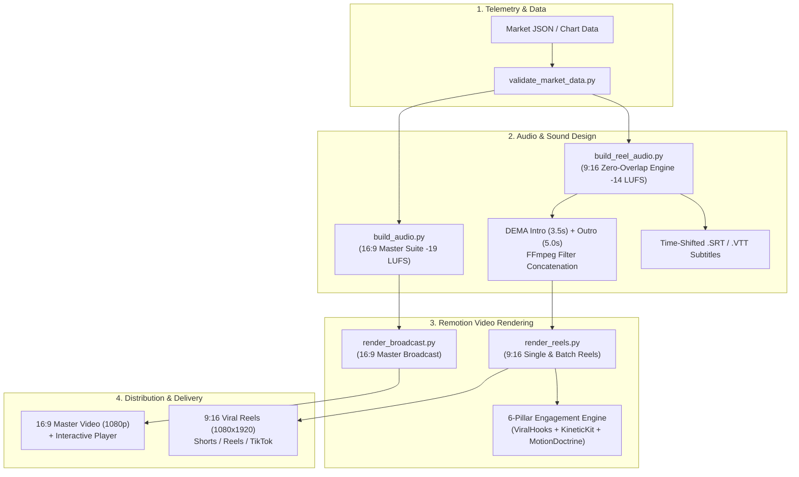

# DEMA Broadcast Master 📺⚡
> **Algorithmic Financial Newsroom & High-Retention Viral Reels Suite for Antigravity & Remotion**

[](https://opensource.org/licenses/MIT)
[](https://www.remotion.dev)
[](https://python.org)
[]()
[]()
[]()

**DEMA Broadcast Master** is an agentic, institutional video production pipeline that transforms daily post-market telemetry data and technical chart studies into complete multi-format video packages:
1. **16:9 Television Newsroom Master Video** (`1920×1080 @ 30fps`, 5 structured acts, mechanical split-flap matrix, global macro split-cards, and order flow footprints).
2. **9:16 Viral Social Reels** (`1080×1920 @ 30fps`, Shorts/Reels/TikTok ready, powered by the **6-Pillar Engagement Formula**).
3. **Zero Voice Overlap Engine** with dynamic sequential chunk scheduling, procedural 120 BPM electronic score bed, and 45Hz sub-bass impact drops.
4. **Master 3-Act Video Sequence**: Branded DEMA Intro Sting (`3.5s / 105 frames`), Dynamic Technical Core, and responsive DEMA Outro End Card (`5.0s / 150 frames`).
5. **Word-by-Word Kinetic Karaoke Captions** burned in real time with radiant `#F2CF1D` gold active pill pops and 3D background watermark climax words.
6. **Time-Shifted Subtitles & Manifests**: Automatically generated frame-accurate `.srt` and `.vtt` closed captions accounting for intro offsets.
7. **Interactive HTML5 Web Streaming Player** with 1-click chapter jumps, WebVTT CC toggle, and instant downloads.

---

## 🏛️ Broadcast Architecture & Visual Doctrine

Built on the `lemo-opuscar` newsroom doctrine and `motion-doctrine` physical motion principles:
* **Palette**: `#121417` (Deep Obsidian Ink), `#1B1E23` (Card Neutral), `#F2CF1D` (Amber Gold Accent), `#10B981` (Bullish Green), `#FE6B3D` (Crimson Alert), `#F4F1E8` (Paper White).
* **Typography**: Barlow Condensed (Display Headers), IBM Plex Mono (Telemetry & Values), Inter (Body UI).
* **Technical Footprint**: Exponential moving averages (20, 50, 100, 200 DEMA ribbons), Volume Profile (VAH, VAL, Point of Control), and institutional absorption radar pulses.



---

## ⚡ The 6-Pillar Engagement Formula (Vertical Reels)

Vertical reels incorporate six specialized motion techniques to maximize watch time, viewer retention, and algorithmic reach:

1. **`viral-hooks` (First 3-Second Retention Trigger)**: Opens with high-stakes institutional money revelation (*"Big institutions just absorbed 1.1 million shares in Cummins India..."*) to arrest feed scrolling immediately.
2. **`remotion-kinetic-kit` (Visual Dynamics)**: Smooth `IntroZoom` (1.09x -> 1.0x in the first 24 frames) coupled with white `FlashCut` pattern interrupts on key cuts.
3. **`motion-doctrine` (Continuous Causal Motion)**: A single continuous camera move tracking price cascades, a physical 16px squash-and-recoil bounce upon hitting POC absorption (₹4,116.10), Z-forward drive into 50 DEMA (₹4,368.15), and a 0.45s stillness-before-climax hold.
4. **`reel-css-animations` (Hardware Glow & Radar UI)**: Rotating conic gradient rims (`#10B981`, `#22D3EE`, `#F2CF1D`) behind quote badges, neon golden floor diffusion on POC, and sonar radar rings on volume candles.
5. **`captions-overlay` (Word-by-Word Kinetic Karaoke)**: 7-word sliding window anchored at `bottom: 240px` with active-word gold pop pill (`#F2CF1D`, scale 1.10), plus giant 3D watermark climax words (`ACCUMULATION`, `LIQUIDATION`, `ABSORPTION`, `BREAKOUT`) floating behind the chart plane.
6. **`glassmorphism` (Obsidian Technical Finishes)**: Dark obsidian frosted glass (`rgba(9, 13, 20, 0.94)`) with 20px blur, 1.5px gold borders, and specular edge highlights.

---

## 🎙️ Zero Voice Overlap Engine (`build_reel_audio.py`)

Static cue scheduling often results in voice overlapping when synthesized TTS durations fluctuate. The DEMA Zero-Overlap Engine measures exact speech durations and schedules chunks dynamically:

$$\text{start\_sec}[i] = \text{end\_sec}[i-1] + \text{INTER\_CHUNK\_PAUSE\_SEC} \quad (\approx 0.45\text{s})$$

* **Integrated Intro & Outro Stings**: Automatically concatenates `dema_intro_sting.mp3` (3.5s) and `dema_outro_bed.mp3` (5.0s) with 1.5s exponential fade-out.
* **Cinematic Sound Effects**: Procedural 120 BPM newsroom score bed with a deep 45Hz sub-bass impact drop on POC hit and an exponential tension riser leading into DEMA tests.
* **Mastering Standard**: EBU R128 normalized to `-14.0 LUFS` with a `-1.5 dBFS` true peak ceiling.

---

## 📦 Directory Structure

```text
dema-broadcast-master/
├── SKILL.md                          # Antigravity skill specification
├── README.md                         # Presentation & quickstart manual
├── LICENSE                           # MIT License
├── .gitignore                        # Standard exclusions
├── scripts/
│   ├── build_audio.py                # 16:9 TTS + 120 BPM score bed + foley + auto-SRT/VTT generator
│   ├── build_reel_audio.py           # 9:16 Zero-overlap TTS engine + SFX + Intro/Outro concatenation
│   ├── render_broadcast.py           # 16:9 Remotion concurrency render + FFmpeg AV muxing
│   ├── render_reels.py               # 9:16 Vertical reels renderer (single & batch) + FFmpeg muxing
│   └── validate_market_data.py       # Strict JSON schema validator for market telemetry
├── templates/
│   ├── CumminsMotionDoctrineReel.jsx # 3-Act Next-Gen Cummins Reel with Intro, Outro & 6-Pillar motion
│   ├── DemaIntro.jsx                 # Master DEMA branded intro sting (3.5s / 105 frames @ 30fps)
│   ├── DemaOutro.jsx                 # Master DEMA responsive outro end card (5.0s / 150 frames @ 30fps)
│   ├── DemaVerticalReels.jsx         # 10 Standalone 9:16 vertical reels for daily market stocks
│   ├── SharedNewsPackage.jsx         # Core UI atoms: KineticBroadcastCaptions, SplitFlapChar, Straps
│   ├── DemaMasterChapters.jsx        # 5-act master broadcast Remotion composition
│   ├── DemaMasterRoot.jsx            # Remotion composition root configuration
│   ├── brand.json                    # Canonical brand tokens (colors, fonts, metadata, handles)
│   └── master-video-player.html      # Interactive streaming web player with CC track
├── schemas/
│   ├── market_data_schema.json       # JSON Schema definition for daily market telemetry
│   └── sample_market_data.json       # Production sample dataset
└── references/
    ├── broadcast-doctrine.md         # 16:9 & 9:16 screen geometry, safe zones, 6-pillar engagement
    ├── sound-design.md               # Zero voice overlap engine, 120 BPM procedural formulas, loudness
    └── caption-system.md             # Kinetic word-by-word karaoke specs, time-shifted subtitles
```

---

## 🚀 Quickstart Guide

### 1. Requirements
* Node.js 18+ and npm
* Python 3.10+ (`numpy`, `edge-tts`, `jsonschema`)
* FFmpeg and FFprobe on PATH

### 2. Vertical Reels Pipeline (e.g. Cummins India)
```bash
# 1. Synthesize zero-overlap audio + intro/outro concatenation + time-shifted subtitles
python scripts/build_reel_audio.py --symbol "CUMMINSIND" --out-dir "outputs/audio"

# 2. Render single vertical reel (with DEMA Intro & Outro)
python scripts/render_reels.py --reel cummins --out-dir "outputs/reels"

# 3. Or batch render all 10 market reels
python scripts/render_reels.py --all --concurrency 4 --out-dir "outputs/reels"
```

### 3. Master 16:9 Television Broadcast
```bash
# 1. Validate daily telemetry numbers
python scripts/validate_market_data.py schemas/sample_market_data.json

# 2. Synthesize 5-chapter broadcast audio
python scripts/build_audio.py --voice "en-IN-PrabhatNeural" --out-dir "outputs/audio"

# 3. Render 16:9 multi-act broadcast video
python scripts/render_broadcast.py --concurrency 4 --audio-dir "outputs/audio" --out-dir "outputs/videos"
```

### 4. Interactive Streaming Web Player
```bash
python -m http.server 8080
```
Open `http://localhost:8080/templates/master-video-player.html` in your browser.

---

## ⚖️ Educational Compliance Disclaimer

All videos produced using this suite carry explicit disclaimers:
> *This broadcast is created strictly for technical chart analysis and educational study. Content does not constitute SEBI-registered investment advice, stock tips, or trading recommendations.*

---

## 📄 License

Distributed under the **MIT License**. See `LICENSE` for details.
