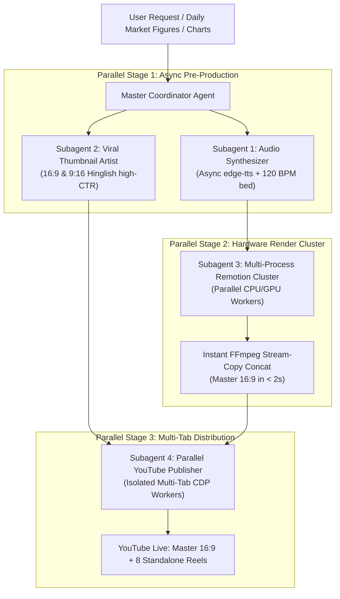

# DEMA Broadcast Master: Ultra-Parallel Multi-Agent Financial Video & Stock Explainer Pipeline

Produce broadcast-grade **16:9 Master Financial Broadcasts**, **16:9 Widescreen Technical Masterclasses**, and **9:16 Viral Social Reels** in record time. Version 3.0 introduces the **Ultra-Parallel Multi-Agent Architecture**: a master coordinator orchestrating dedicated subagents and multi-worker clusters that execute voiceover synthesis, procedural score generation, viral thumbnail design, Remotion hardware rendering, and YouTube Studio uploads **completely in parallel**.



---

## 1. When to Use This Skill

Activate this skill whenever the user asks to:
- "Generate today's DEMA analysis video" or "make daily market broadcast"
- "Create videos in parallel" or "make video generation faster with subagents"
- "Create viral thumbnails in Hinglish/English" while rendering
- "Upload all reels and videos to YouTube in parallel"
- "Create a viral 9:16 reel for a stock" (e.g. Cummins India, Coal India, IIFL Cap, Blue Star, ABB, Waaree)
- "Render full explainer video like Cummins" for any stock with an attached chart image
- "Produce 16:9 single-stock YouTube explainer" or "16:9 technical masterclass"
- "Apply motion-doctrine on a stock chart" or "make technical breakdown reel"
- "Add DEMA intro and outro to the video"
- "Produce 16:9 financial newsroom broadcast with split-flap board and charts"

---

## 2. Ultra-Parallel Multi-Agent Roles

| Role | Engine / Script | Concurrency Model | Execution Output |
|---|---|---|---|
| **Master Coordinator** | `run_parallel_broadcast.py` | Orchestration thread pool | Validates inputs, coordinates subagents, generates run report. |
| **Voice & Score Synthesizer** | `parallel_audio_synthesizer.py` | Asyncio + ProcessPoolExecutor | Parallel `edge-tts` chunks (`en-IN-PrabhatNeural`), 120 BPM bed, `-14 LUFS` EBU R128 mix. |
| **Viral Thumbnail Artist** | `generate_viral_thumbnail.py` | Background ThreadPool | Simultaneous 16:9 Master Viral Thumbnail + 9:16 Reel Thumbnails with Hinglish punchlines. |
| **Remotion Render Cluster** | `parallel_remotion_cluster.py` | Multi-Process Worker Pool (2-4 workers) | Concurrent Remotion composition renders + instant FFmpeg zero-loss stream copy concat. |
| **Parallel YouTube Publisher** | `parallel_youtube_publisher.mjs` | Multi-Tab Puppeteer / CDP (2-3 tabs) | Concurrent video file uploads, metadata population, custom thumbnail assignment, and publishing. |

---

## 3. Format & Production Matrix

| Feature | 16:9 Master Television Broadcast | 16:9 Stock YouTube Masterclass | 9:16 Viral Stock Reel (Shorts/Reels) |
|---|---|---|---|
| **Resolution** | `1920 × 1080` (Horizontal 16:9) | `1920 × 1080` (Horizontal 16:9) | `1080 × 1920` (Vertical 9:16) |
| **Frame Rate** | 30.00 fps | 30.00 fps | 30.00 fps |
| **Narrative Structure** | 5-8 Acts (~11m to 25m total) | 3 Acts (`DemaIntro` 3.5s + 6-Beat Body + `DemaOutro` 5.0s) | 3 Acts (`DemaIntro` 3.5s + 6-Beat Body + `DemaOutro` 5.0s) |
| **Audio Engine** | `parallel_audio_synthesizer.py` | `build_stock_explainer_audio.py` | `parallel_audio_synthesizer.py` / `build_reel_audio.py` |
| **Loudness Spec** | EBU R128 `-19.0 LUFS` / `-14.0 LUFS` (Peak: `-1.5 dBFS`) | EBU R128 `-14.0 LUFS` (Peak: `-1.5 dBFS`) | EBU R128 `-14.0 LUFS` (Peak: `-1.5 dBFS`) |
| **Caption Overlay** | `BroadcastCaptionOverlay` (10-word window) | `KineticBroadcastCaptions` (10-word window, `top: 86px`) | `KineticBroadcastCaptions` (7-word window, `bottom: 240px`) |
| **Layout Dynamics** | Full-width split-flap mechanical board & cards | 1390px Chart + 470px Level Matrix Telemetry Sidebar | Centered 1040x980 Chart Canvas + Watermark Climax |
| **Parallel Render** | `parallel_remotion_cluster.py` | `parallel_remotion_cluster.py` | `parallel_remotion_cluster.py` |

---

## 4. Production Runbooks

### Runbook A: End-to-End Parallel Suite Execution (Recommended)

Run the entire pipeline—audio, video rendering, viral thumbnail design, and multi-tab YouTube publishing—in parallel:

```bash
# 1. Master Parallel Command (All tasks in parallel)
python .agents/skills/dema-broadcast-master/scripts/run_parallel_broadcast.py \
  --market-data data/dema_suite_20261113.json \
  --out-dir DEMA_Daily_Study_Pack \
  --render-workers 3 \
  --upload-workers 2 \
  --upload
```

---

### Runbook B: Parallel Audio & Viral Thumbnail Generation

While Remotion is preparing or rendering, generate audio and thumbnails concurrently:

```bash
# Generate audio chunks asynchronously
python .agents/skills/dema-broadcast-master/scripts/parallel_audio_synthesizer.py

# Generate 16:9 Viral Thumbnail with Hinglish punchline
python .agents/skills/dema-broadcast-master/scripts/generate_viral_thumbnail.py \
  --format 16x9 \
  --out outputs/thumbnails/DEMA_Master_Viral_Thumbnail.jpg \
  --headline "NIFTY 50 BREAKOUT & GOLD SURGE" \
  --sub "136M Volume Blast! बड़ा उलटफेर शुरू?" \
  --chart modi-remotion/public/charts/FIRSTCRY_1D_chart.png

# Generate 9:16 Vertical Reel Thumbnail
python .agents/skills/dema-broadcast-master/scripts/generate_viral_thumbnail.py \
  --format 9x16 \
  --out outputs/thumbnails/DEMA_Reel_FIRSTCRY_9x16_thumb.jpg \
  --headline "FIRSTCRY BREAKOUT" \
  --sub "12.8% Blast या Trap?" \
  --ticker "FIRSTCRY" \
  --chart modi-remotion/public/charts/FIRSTCRY_1D_chart.png
```

---

### Runbook C: Parallel Multi-Process Remotion Video Cluster

Distribute Remotion rendering across worker processes:

```bash
# Render all 8 chapters and 8 reels concurrently (workers=3)
python .agents/skills/dema-broadcast-master/scripts/parallel_remotion_cluster.py
```
- Chapter 1 through Chapter 8 render in parallel.
- Standalone Reels render in parallel.
- Fast FFmpeg stream-copy concatenates the 16:9 master broadcast with zero re-encoding loss in under 2 seconds.

---

### Runbook D: Multi-Tab Parallel YouTube Studio Publisher

Upload multiple videos and reels concurrently via isolated browser tabs:

```bash
# Upload all videos from manifest across 2-3 concurrent Studio tabs
node .agents/skills/dema-broadcast-master/scripts/parallel_youtube_publisher.mjs upload_manifest.json 2
```
- Each worker tab operates independently on `https://studio.youtube.com`.
- Automatically assigns Title, Description, Audience (`VIDEO_MADE_FOR_KIDS_NOT_MFK`), Custom Thumbnail, and Public Visibility.
- Generates `upload_manifest_published.json` with verified live links.

---

## 5. Directory Structure & Key Assets

```text
.agents/skills/dema-broadcast-master/
├── SKILL.md                                 # Master instruction manual (v3.0.0)
├── README.md                                # Public repository documentation
├── scripts/
│   ├── run_parallel_broadcast.py            # Master parallel pipeline coordinator
│   ├── parallel_audio_synthesizer.py        # Async edge-tts + 120 BPM news bed + loudnorm
│   ├── parallel_remotion_cluster.py         # Multi-process Remotion render cluster + FFmpeg concat
│   ├── generate_viral_thumbnail.py          # High-CTR 16:9 and 9:16 viral thumbnail generator
│   ├── parallel_youtube_publisher.mjs       # Multi-tab concurrent YouTube Studio uploader
│   ├── build_stock_explainer_audio.py       # Universal 6-beat stock explainer audio + manifest
│   ├── render_stock_explainers.py           # Universal stock explainer renderer
│   ├── build_audio.py                       # 16:9 broadcast TTS + 120 BPM bed + foley
│   ├── build_reel_audio.py                  # 9:16 Zero-overlap TTS engine + SFX
│   ├── render_broadcast.py                  # 16:9 Remotion concurrency render
│   ├── render_reels.py                      # 9:16 Vertical reels renderer
│   └── validate_market_data.py              # JSON schema validator for daily telemetry
├── templates/
│   ├── StockExplainerReel.jsx               # Universal 9:16 Vertical Explainer Reel
│   ├── StockYouTubeExplainer16x9.jsx        # Universal 16:9 Widescreen Explainer Masterclass
│   ├── CumminsYouTubeExplainer16x9.jsx      # Benchmark 16:9 Widescreen YouTube Explainer
│   ├── CumminsExplainerReel.jsx             # Benchmark 9:16 Support/Resistance Masterclass Reel
│   ├── CumminsMotionDoctrineReel.jsx        # 3-Act Next-Gen Cummins Reel
│   ├── DemaIntro.jsx                        # Master DEMA branded intro sting (3.5s)
│   ├── DemaOutro.jsx                        # Master DEMA responsive outro end card (5.0s)
│   ├── DemaMasterRoot.jsx                   # Universal Remotion Root
│   ├── SharedNewsPackage.jsx                # UI components: Captions, Straps, Wipes
│   ├── DemaMasterChapters.jsx               # Complete 5-act broadcast Remotion component
│   └── brand.json                           # Canonical brand tokens
├── schemas/
│   ├── market_data_schema.json              # JSON Schema definition for daily market telemetry
│   └── sample_market_data.json              # Example daily market data with image references
└── references/
    ├── decluttered-laser-doctrine.md        # Single-level isolation, laser sweep specs
    ├── broadcast-doctrine.md                # Screen geometry, safe zones, 6-pillar engagement
    ├── sound-design.md                      # Zero voice overlap engine, 120 BPM formulas
    └── caption-system.md                    # Kinetic word-by-word karaoke specs
```

---

## 6. Verification Checklist

Before publishing or delivering any generated video:
- [ ] **Parallel Execution**: Confirm audio, thumbnails, and Remotion rendering executed concurrently.
- [ ] **Zero Voice Overlap**: Confirm sequential chunks have `start_sec[i] >= end_sec[i-1] + 0.45s`.
- [ ] **Audio Loudness**: Verify with FFprobe: Integrated loudness ~ `-14 LUFS` (Peak: `-1.5 dBFS`).
- [ ] **Hinglish Viral Thumbnail**: Verify master thumbnail contains high-contrast title, Hinglish punchline, verified chart zoom, and compliance note.
- [ ] **Zero-Loss Concat**: Verify master 16:9 video chapters are concatenated with clean audio sync and no re-encoding artifacts.
- [ ] **Multi-Tab YouTube Publishing**: Verify all videos are published as `Public` with correct titles, descriptions, and custom thumbnails.
