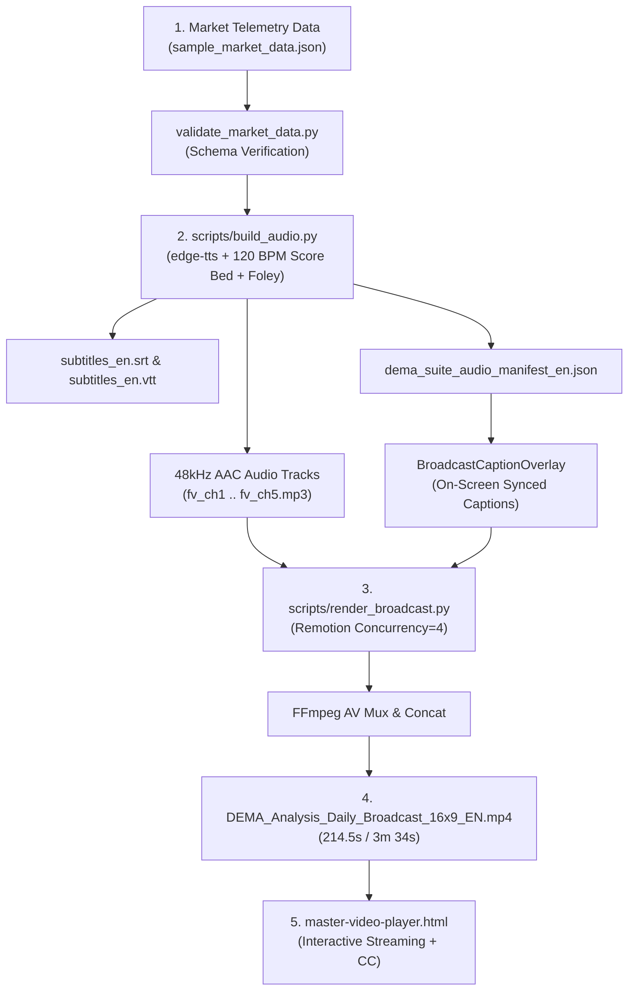

# DEMA Broadcast Master: 16:9 Daily Financial Video Suite

Create institutional-grade 16:9 financial broadcast videos from daily post-market telemetry data. This skill packages the complete end-to-end production workflow: daily data validation, high-fidelity English narration, procedural 120 BPM score synthesis, tactile split-flap foley, synchronized on-screen caption capsules (`BroadcastCaptionOverlay`), Remotion rendering, automated FFmpeg AV muxing, and interactive web playback.

---

## 1. When to Use This Skill

Activate this skill whenever the user asks to:
- "Generate today's DEMA analysis video" or "make daily market broadcast"
- "Create financial video like AdaniPower suite" or "use the DEMA master template"
- "Render master market recap video in English with captions"
- "Produce 16:9 financial newsroom broadcast with split-flap board and charts"
- "Update the daily market data and export the full video"

---

## 2. Pipeline Overview



---

## 3. Quickstart Production Runbook

To produce a daily broadcast suite from scratch or with new closing data, execute the 4 standard steps:

### Step 1: Validate Market Telemetry Data
Ensure today's market numbers (Nifty 50, Commodities, Top Gainers/Losers, Featured Deep Dive) conform to the strict schema:
```bash
python .agents/skills/dema-broadcast-master/scripts/validate_market_data.py path/to/daily_market_data.json
```

### Step 2: Generate English Audio & Subtitles
Synthesizes `en-IN-PrabhatNeural` narration, procedural 120 BPM financial score bed, split-flap foley, whoosh wipes, and auto-generates `.srt` and `.vtt` subtitles:
```bash
python .agents/skills/dema-broadcast-master/scripts/build_audio.py --voice "en-IN-PrabhatNeural" --out-dir "outputs/audio"
```
*Outputs: 5 chapter audio tracks (`fv_ch1.mp3` through `fv_ch5.mp3`), `dema_suite_audio_manifest_en.json`, `subtitles_en.srt`, `subtitles_en.vtt`.*

### Step 3: Render & Concatenate 16:9 Master Broadcast
Executes Remotion rendering across all 5 acts with concurrency, muxes audio, and creates the single unified master video:
```bash
python .agents/skills/dema-broadcast-master/scripts/render_broadcast.py --concurrency 4 --audio-dir "outputs/audio" --out-dir "outputs/videos"
```
*Outputs: `DEMA_Analysis_Daily_Broadcast_16x9_EN.mp4` (`1920x1080 @ 30fps`, ~18.7 MB, ~3m 34s duration).*

### Step 4: Preview on Interactive Web Player
Launch the local streaming server to review video playback, chapter skipping, and WebVTT captions:
```bash
python -m http.server 8080
```
Open: `http://localhost:8080/master-video-player.html`

---

## 4. Five-Act Narrative Structure

The video is divided into 5 focused chapters matching institutional post-market broadcasts:

| Act | Name | Target Duration | Visual Surface & Content |
|---|---|---|---|
| **Act 1** | **Executive Briefing & Telemetry** | `31.5s` | 3D mechanical split-flap matrix displaying post-market headline, date badge, mandatory educational disclaimer, and institutional telemetry overview. |
| **Act 2** | **Global Macro, Crude & Metals** | `47.5s` | Split multi-card array: Nifty 50 intraday pull-back, Gold COMEX ($3,886), Silver ATH, WTI ($89.14) & Brent ($96.81) energy surge, US 10Y Treasury yield, and DXY. |
| **Act 3** | **Sectoral Heatmap & Movers** | `49.0s` | Top gainers table (Eicher, HUL, Hero Moto), top losers drag (Shriram Finance, BPCL), and high-volume breakout radar (e.g. Moneyview 96.8M volume spike). |
| **Act 4** | **Technical Deep Dive & Order Flow** | `56.5s` | Institutional technical chart: 200 DEMA golden squeeze ribbon, 20/50/100 moving averages, Volume Profile horizontal footprint, Point of Control (POC), and Value Area High/Low. |
| **Act 5** | **Tomorrow's Strategy & Range Plan** | `30.0s` | Actionable support floor, pivot level, and overhead resistance levels, tactical risk-management guidelines, and subscribe CTA bumper. |

---

## 5. UI & Kinetic Caption Doctrine

1. **`KineticBroadcastCaptions` / `BroadcastCaptionOverlay` (`SharedNewsPackage.jsx`)**:
   - **Reel-Standard Kinetic Word-by-Word Karaoke**: Captions follow the viral reel kinetic styling (`PageindReel` / Vox-style). Words are synchronized dynamically to audio chunks in real time.
   - **Active Word Pill Pop**: The currently spoken word pops with a radiant yellow accent pill (`#F2CF1D`), dark ink text (`#121417`), bold weight `800`, scale `1.10`, and glowing accent shadow (`0 0 16px #F2CF1D`).
   - **Prior Spoken Words**: Rendered in crisp, high-contrast white (`#FFFFFF`, weight `700`).
   - **Upcoming Words in Phrase**: Rendered in soft translucent paper (`rgba(244, 241, 232, 0.45)`, weight `500`).
   - **Sliding Word Window (Anti-Clutter)**: Displays a sliding window of **7 words on 9:16 vertical reels** and **10 words on 16:9 master broadcasts**. As the narrator speaks, the window smoothly shifts forward, keeping the text concise and preventing chart occlusion.
   - **Dual Safe Zone Placement**:
     - **16:9 Master Broadcast**: Positioned at `bottom: 122px` (centered horizontally, max width 1380px), resting directly above `LowerThirdStrap` (`bottom: 24px`, height `92px`).
     - **9:16 Vertical Reels**: Positioned at `bottom: 228px` (centered with `left: 44px, right: 44px`), resting directly above the vertical `LowerThirdStrap` (`bottom: 112px`).
   - **Manifest Auto-Resolution**: Automatically reads `chapterId` or `reelId` and resolves speech chunks from `dema_suite_audio_manifest_en.json`.
2. **`WideChapterShell` & `VerticalReelShell`**:
   - Master 16:9 and vertical 9:16 shells providing unified channel bug, breadcrumbs, educational compliance ribbons, and responsive lower third straps.
3. **Reference Docs**:
   - [broadcast-doctrine.md](./references/broadcast-doctrine.md) — Screen geometry, safe zones, and component anatomy.
   - [sound-design.md](./references/sound-design.md) — 120 BPM procedural score formulas, foley synthesis, and loudness normalization.
   - [caption-system.md](./references/caption-system.md) — Full kinetic word-by-word karaoke rules, WebVTT/SRT generator, and styling specs.

---

## 6. Directory Structure & Key Assets

```text
.agents/skills/dema-broadcast-master/
├── SKILL.md                          # This master instruction manual
├── scripts/
│   ├── build_audio.py                # English TTS + 120 BPM score bed + foley + auto-SRT/VTT generator
│   ├── render_broadcast.py           # Automated Remotion render + FFmpeg muxing + concat
│   └── validate_market_data.py       # JSON schema validator for daily telemetry
├── templates/
│   ├── DemaMasterChapters.jsx        # Complete 5-act broadcast Remotion component with BroadcastCaptionOverlay
│   ├── SharedNewsPackage.jsx         # UI atoms: WideChapterShell, LowerThirdStrap, SplitFlapChar, etc.
│   ├── DemaMasterRoot.jsx            # Remotion composition root configuration
│   └── master-video-player.html      # Interactive web video player with WebVTT CC support
├── schemas/
│   ├── market_data_schema.json       # JSON Schema definition for daily market telemetry
│   └── sample_market_data.json       # Example daily market data (indices, commodities, stocks)
└── references/
    ├── broadcast-doctrine.md         # Screen hierarchy, safe zones, split-flap timing
    ├── sound-design.md               # 120 BPM procedural financial score bed formulas & foley
    └── caption-system.md             # Reel-style on-screen capsule overlay doctrine & WebVTT/SRT
```

---

## 7. Verification Checklist

Before publishing or delivering a newly generated broadcast:
- [ ] Run `validate_market_data.py` to confirm all index and stock quotes are present and numeric.
- [ ] Verify `dema_suite_audio_manifest_en.json` contains valid frame cues and chunk texts.
- [ ] Verify audio loudness with FFmpeg: integrated loudness ~ `-19 LUFS`, peak ceiling < `-3.0 dBFS`.
- [ ] Verify final video resolution is 1920×1080 @ 30.00 fps, video codec is H.264, audio is AAC 48kHz stereo.
- [ ] Verify that `KineticBroadcastCaptions` renders active word-by-word karaoke highlights in both 16:9 master chapters and 9:16 vertical reels with no chart obstruction.
- [ ] Verify both `subtitles_en.srt` and `subtitles_en.vtt` are populated with valid sequential timestamps.

